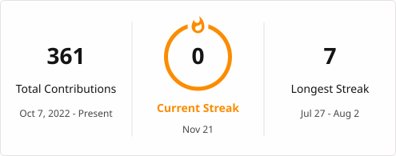

# Hi, I'm Yinkun (Kane) Qu 👋

### Software Engineer · AI Agents & LLM Systems · Computer Architecture

  
  
  
  

**Yinkun (Kane) Qu** is a software engineer based in Chicago and an MS student in Electrical and Computer Engineering at the University of Illinois Chicago (UIC), with a BS in Computer Science. Kane builds LLM agents, retrieval-augmented generation (RAG) pipelines, and Java/Python backend services, and does computer architecture research with gem5 and SimpleScalar.

---

## About Me

- 🤖 **AI systems:** LLM agents, RAG, tool calling, evaluation, and LLMs applied to hardware design
- 🛠️ **Backend engineering:** REST APIs with Spring Boot and FastAPI, PostgreSQL/Redis, Docker, AWS
- 🔬 **Computer architecture & HPC:** memory systems, branch prediction, MPI parallel programming
- 🌱 **Open to:** software engineering and AI engineering roles, open-source collaboration

---

## Featured Projects

<table>
<tr>
<td width="50%" valign="top">

### 🧭 [FromPython2Agent](https://github.com/KaneYin/FromPython2Agent)

Open learning roadmap from Python basics to machine learning, deep learning, LLMs, RAG, AI agents and FastAPI. Hands-on Jupyter notebooks with self-check cells.

`Python` `PyTorch` `NumPy` `RAG` `FastAPI`

</td>
<td width="50%" valign="top">

### 🧵 [Weft (SmartObsidian)](https://github.com/KaneYin/SmartObsidian)

Local-first AI assistant over an Obsidian Markdown vault: graph-aware RAG, inferred-link suggestions, and durable agent memory across sessions.

`Python` `RAG` `AI agents` `CLI`

</td>
</tr>
<tr>
<td width="50%" valign="top">

### ⚡ [Automated SPICE Code Generation](https://github.com/KaneYin/Automated-SPICE-Code-Generation)

LLM framework that generates SPICE netlists for analog circuits and optimizes performance–cost tradeoffs. Builds on AnalogCoder (AAAI 2025).

`Python` `LLM` `EDA` `Analog circuits`

</td>
<td width="50%" valign="top">

### 🧠 [DPRH](https://github.com/KaneYin/DPRH)

gem5 memory-controller research on scheduling demand vs. prefetch DRAM requests (SPP prefetcher, DDR4, FR-FCFS), with microbenchmark-driven evaluation.

`C++` `Python` `gem5` `DRAM`

</td>
</tr>
</table>

**More projects**

- [Focus Tracker](https://github.com/KaneYin/promodoro_timer): two-person Pomodoro app with ActivityWatch screen-time leaderboards (FastAPI, SQLite, vanilla JS)
- [Gshare branch predictor](https://github.com/KaneYin/Computer-Architecture-Final-Project): Gshare implemented in the SimpleScalar 3.0 simulator (C)
- [Parallel quicksort with load balancing](https://github.com/KaneYin/cs566_final): MPI sort on an 8-processor 3D hypercube (C, MPI)
- [Awesome Mac Terminal Setup](https://github.com/KaneYin/Awesome_Mac_Terminal_Setup): one-command Ghostty + Zsh + Starship setup, Catppuccin themed (Shell)

---

## Technical Focus

<table>
<tr>
<td width="50%" valign="top">

### Backend & Infrastructure

- Java and Spring Boot
- Python and FastAPI
- RESTful API design
- PostgreSQL, MySQL, and Redis
- Docker, Nginx, and AWS
- Unit and integration testing

</td>
<td width="50%" valign="top">

### AI & Systems

- AI agents and RAG pipelines
- LangChain and LangGraph workflows
- PyTorch model development
- NumPy and data processing
- Computer architecture simulation (gem5, SimpleScalar)
- HPC and parallel programming (MPI)

</td>
</tr>
</table>

---

## Languages and Tools

### Core Languages

### Backend and Data

### AI and Scientific Computing

### Infrastructure and Development

---

## Developer Activity

---

## Connect with Me

I'm interested in open-source collaboration, backend engineering,
AI infrastructure, and computer architecture research.

**[LinkedIn](https://www.linkedin.com/in/yinkun/) · [Technical Blog](https://kaneyin.github.io/blog/) · [Email](mailto:yinkunq@gmail.com)**

